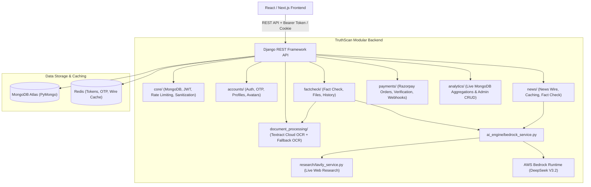

# TruthScan AI — Python & Django REST Framework Backend

An enterprise-grade, modular, high-performance REST API backend for **TruthScan AI**, migrated from Node.js + Express.js to **Python + Django REST Framework (DRF)**.

**TruthScan AI** is an AI-powered misinformation detection, forensic evidence verification, and fact-checking intelligence platform.

---

## 🏛️ System Architecture

All fact-checking and scanning requests (News Wire, Text/URL/File, Camera Scan) route through a unified live research and AI analysis pipeline:



---

## 🚀 Tech Stack

- **Language**: Python 3.10+ / 3.14
- **Web Framework**: Django 5.x / 6.x
- **API Engine**: Django REST Framework (DRF)
- **Database**: MongoDB Atlas via **PyMongo** (Direct BSON/ObjectId integration, no relational migrations)
- **Cache & Key-Value Store**: Redis (via `redis-py` with auto-TLS support & resilient in-memory fallback)
- **Email Service**: Direct Brevo SMTP email delivery via `smtplib` (with console logging fallback for development environments, requiring zero standalone workers or BullMQ dependencies)
- **Authentication**: Custom DRF JWT Authentication (`PyJWT`) with bcrypt password hashing
- **AI Engine**: AWS Bedrock Runtime via `boto3` invoking `deepseek.v3.2`
- **Research Engine**: Tavily Live Web Search API with relevance filtering & spam suppression
- **Document & Image Extraction**: AWS Textract (`boto3`) + dual-engine OCR (pytesseract/PIL) + `pypdf`
- **Payment Gateway**: Razorpay Python SDK with HMAC-SHA256 signature verification
- **Media Storage**: Cloudinary Python SDK (`cloudinary.uploader`)
- **Email Delivery**: Python `smtplib` + Brevo SMTP relay
- **Production Server**: Gunicorn WSGI

---

## 📁 Modular Directory Structure

```
backend/
├── config/
│   ├── __init__.py
│   ├── settings.py         # Django settings, CORS, MongoDB & JWT configuration
│   ├── urls.py             # Master URL routing (primary /api and fallback mounts)
│   ├── wsgi.py             # WSGI entrypoint for Gunicorn
│   └── asgi.py             # ASGI entrypoint
├── core/
│   ├── mongodb.py          # PyMongo client, DB collections & ObjectId helpers
│   ├── authentication.py   # MongoUser class & TruthScanJWTAuthentication
│   ├── permissions.py      # IsAuthenticatedMongoUser & IsAdminMongoUser
│   ├── utils.py            # Response sanitizer, SSRF guard, JWT & OTP helpers
│   ├── ratelimit.py        # Redis rate limiters
│   ├── exceptions.py       # Standardized JSON error response handler
│   └── tests.py            # Core unit tests
├── accounts/
│   ├── views.py            # Register, send OTP, verify OTP, login, refresh, logout, profile
│   ├── serializers.py      # DRF request validation serializers
│   ├── services.py         # Password hashing, Cloudinary avatar uploads
│   └── tests.py            # Accounts & auth integration tests
├── factcheck/
│   ├── views.py            # Fact check (text, URL, file), history, detail, scan
│   ├── serializers.py      # FactCheck input serializers
│   ├── services.py         # Free-trial 2-check limit enforcement
│   └── tests.py            # FactCheck integration tests
├── news/
│   ├── views.py            # News list, refresh, article fact check
│   ├── services.py         # NewsAPI ingestion with 5-minute Redis caching
│   └── urls.py             # News endpoints
├── payments/
│   ├── views.py            # Order creation, verification, webhooks
│   ├── services.py         # Razorpay checkout order & HMAC verification
│   └── tests.py            # Payments integration tests
├── ai_engine/
│   ├── bedrock_service.py  # Boto3 AWS Bedrock DeepSeek integration & validation
│   ├── langchain_service.py# Compatibility layer
│   ├── prompts.py          # Grounded synthesis prompts
│   └── tests.py            # AI Engine unit tests
├── research/
│   ├── tavily_service.py   # Live web evidence collector & relevance assessment
│   └── tests.py            # Research & spam pattern tests
├── document_processing/
│   ├── textract_service.py # AWS Textract & PDF / OCR parsing
│   └── tests.py            # File extraction tests
├── analytics/
│   ├── views.py            # Live metrics dashboard & admin user management
│   ├── services.py         # Direct MongoDB aggregations
│   └── tests.py            # Analytics tests
├── manage.py               # Django management CLI
├── requirements.txt        # Python production dependencies
├── Procfile                # Render deployment configuration
└── .env                    # Environment configuration
```

---

## 📡 API Endpoints Reference

All endpoints are available both with the `/api` prefix and without (fallback mode for frontend backwards compatibility):

### Authentication & User Clearance
| Method | Endpoint | Auth | Description |
|---|---|---|---|
| `POST` | `/api/auth/register` | None (Rate Limited) | Initiates account clearance, sends 6-digit OTP |
| `POST` | `/api/auth/send-otp` | None (Rate Limited) | Dispatches fresh verification OTP |
| `POST` | `/api/auth/verify-otp` | None (Rate Limited) | Verifies OTP code, returns access token, sets refresh cookie |
| `POST` | `/api/auth/login` | None (Rate Limited) | Authenticates investigator credentials |
| `POST` | `/api/auth/refresh` | Cookie | Exchanges refresh cookie for new access token |
| `POST` | `/api/auth/logout` | Optional Cookie | Revokes refresh token in Redis and clears cookie |
| `GET` | `/api/users/profile` | JWT (`Bearer`) | Retrieves user clearance, tier, and trial usage |
| `PUT` | `/api/users/profile` | JWT (`Bearer`) | Updates user clearance name |
| `POST` | `/api/users/avatar` | JWT (`Bearer`) | Uploads profile photo to Cloudinary |

### Fact Checking & Image Scanner
| Method | Endpoint | Auth | Description |
|---|---|---|---|
| `POST` | `/api/fact-check` | JWT (`Bearer`) | Fact checks text claim or validated URL |
| `POST` | `/api/fact-check/file` | JWT (`Bearer`) | Ingests PDF, TXT, PNG, JPG and verifies content |
| `GET` | `/api/fact-check/history` | JWT (`Bearer`) | Paginated audit trail for current user |
| `GET` | `/api/fact-check/:id` | JWT (`Bearer`) | Retrieves single fact check dossier |
| `POST` | `/api/scan` | JWT (`Bearer`) | Camera / Optical lens OCR via Amazon Textract + AI fact check |

### News Wire
| Method | Endpoint | Auth | Description |
|---|---|---|---|
| `GET` | `/api/news` | None | Retrieves latest news wire (5-min Redis cache) |
| `GET` | `/api/news/refresh` | None | Forces wire refresh from NewsAPI.org |
| `POST` | `/api/news/fact-check` | Optional JWT | Fact checks news wire dispatch |

### Payments & Premium Upgrades
| Method | Endpoint | Auth | Description |
|---|---|---|---|
| `POST` | `/api/payments/create-order` | JWT (`Bearer`) | Creates Razorpay order for ₹200/mo or ₹2,000/yr |
| `POST` | `/api/payments/verify` | JWT (`Bearer`) | Verifies HMAC-SHA256 signature and elevates clearance |
| `POST` | `/api/payments/webhook` | Signature Header | Razorpay webhook notification handler |

### Dedicated Administrator Core (`/api/admin`)
| Method | Endpoint | Auth | Description |
|---|---|---|---|
| `POST` | `/api/admin/login` | Rate Limited (5 req/10m) | Dedicated admin authentication, validates `role == 'admin'` |
| `POST` | `/api/admin/logout` | Admin (`Bearer`) | Terminates admin session, revokes refresh token |
| `GET` | `/api/admin/profile` | Admin (`Bearer`) | Returns authenticated admin profile |
| `GET` | `/api/admin/dashboard/stats` | Admin (`Bearer`) | Overview KPIs with period-over-period growth rates |
| `GET` | `/api/admin/dashboard/charts` | Admin (`Bearer`) | Telemetry datasets (timeline, verdicts, growth, categories, AI) |
| `GET` | `/api/admin/users` | Admin (`Bearer`) | Search, filter, and paginate all investigators |
| `POST` | `/api/admin/users` | Admin (`Bearer`) | Create new user account directly in MongoDB |
| `GET` | `/api/admin/users/:id` | Admin (`Bearer`) | User detail with audit volume and activity logs |
| `PATCH` | `/api/admin/users/:id` | Admin (`Bearer`) | Modify user clearance, suspend, or reset credentials |
| `DELETE` | `/api/admin/users/:id` | Admin (`Bearer`) | Soft or hard deletion (primary admin protected) |
| `GET` | `/api/admin/fact-checks` | Admin (`Bearer`) | Filter audits by verdict/category/date, CSV export (`?export=csv`) |
| `GET` | `/api/admin/fact-checks/:id` | Admin (`Bearer`) | Full dossier inspection (AI explanations, evidence, sources) |
| `POST` | `/api/admin/fact-checks/:id/review` | Admin (`Bearer`) | Record admin decision & notes without modifying AI verdict |
| `DELETE` | `/api/admin/fact-checks/:id` | Admin (`Bearer`) | Delete inappropriate or duplicate audit record |
| `GET` | `/api/admin/news` | Admin (`Bearer`) | Paginated news management list |
| `POST` | `/api/admin/news` | Admin (`Bearer`) | Publish custom news wire article |
| `PATCH` | `/api/admin/news/:id` | Admin (`Bearer`) | Update news content or toggle published/draft |
| `DELETE` | `/api/admin/news/:id` | Admin (`Bearer`) | Delete news wire article |
| `GET` | `/api/admin/categories` | Admin (`Bearer`) | Domain categories with real fact-check reference count |
| `POST` | `/api/admin/categories` | Admin (`Bearer`) | Create domain category |
| `PATCH` | `/api/admin/categories/:id` | Admin (`Bearer`) | Update category name, description, color, active state |
| `DELETE` | `/api/admin/categories/:id` | Admin (`Bearer`) | Safe deletion with reference validation and reassignment |
| `GET` | `/api/admin/monitoring/ai` | Admin (`Bearer`) | AWS Bedrock, Textract & Tavily request volume and error rates |
| `GET` | `/api/admin/activity-logs` | Admin (`Bearer`) | Immutable administrative audit ledger |
| `GET` | `/api/admin/settings` | Admin (`Bearer`) | Retrieve administrator preferences and telemetry defaults |
| `PATCH` | `/api/admin/settings` | Admin (`Bearer`) | Save interface preferences and alert toggles |
| `POST` | `/api/admin/settings/change-password` | Admin (`Bearer`) | Securely change administrator credentials |

### System Health
| Method | Endpoint | Auth | Description |
|---|---|---|---|
| `GET` | `/health` | None | Production health probe |
| `GET` | `/api/health` | None | Production health probe |

---

## 🛠️ Local Setup & Execution

### 1. Create and Activate Virtual Environment
```bash
python3 -m venv .venv
source .venv/bin/activate
```

### 2. Install Dependencies
```bash
pip install -r requirements.txt
```

### 3. Verify Environment File
Ensure your `.env` contains:
```env
PORT=4000
NODE_ENV=development
CLIENT_URL=http://localhost:3000
MONGO_URI=mongodb+srv://<username>:<password>@cluster.mongodb.net/TruthScanAI?retryWrites=true&w=majority
JWT_ACCESS_SECRET=your_jwt_access_secret
JWT_REFRESH_SECRET=your_jwt_refresh_secret
AWS_REGION=ap-south-1
AWS_ACCESS_KEY_ID=your_aws_access_key
AWS_SECRET_ACCESS_KEY=your_aws_secret_key
BEDROCK_MODEL_ID=deepseek.v3.2
TAVILY_API_KEY=your_tavily_api_key
RAZORPAY_KEY_ID=your_razorpay_key
RAZORPAY_KEY_SECRET=your_razorpay_secret
CLOUDINARY_CLOUD_NAME=your_cloud_name
CLOUDINARY_API_KEY=your_cloudinary_key
CLOUDINARY_API_SECRET=your_cloudinary_secret
```

### 4. Initialize Primary Administrator & Taxonomies
```bash
python manage.py setup_admin
```
*Creates or updates `id-admin@gmail.com` with `role: "admin"`, seeds default categories, initial news wire dispatches, and dashboard settings into MongoDB Atlas.*

### 5. Run Automated Tests
```bash
python manage.py test
```

### 6. Start Development Server
```bash
python manage.py runserver 0.0.0.0:4000
```
Or with Gunicorn:
```bash
gunicorn config.wsgi:application --bind 0.0.0.0:4000 --workers 3
```

---

## ☁️ Deployment on Render

1. **Create Web Service** on Render pointing to your repository.
2. **Root Directory**: `TruthScanAI-V2/backend` (or repo root if backend is root).
3. **Runtime**: `Python 3`
4. **Build Command**:
   ```bash
   pip install -r requirements.txt
   ```
5. **Start Command**:
   ```bash
   gunicorn config.wsgi:application --bind 0.0.0.0:$PORT --workers 3 --timeout 120
   ```
6. **Environment Variables**:
   Add all keys from your `.env` directly in the Render dashboard.
